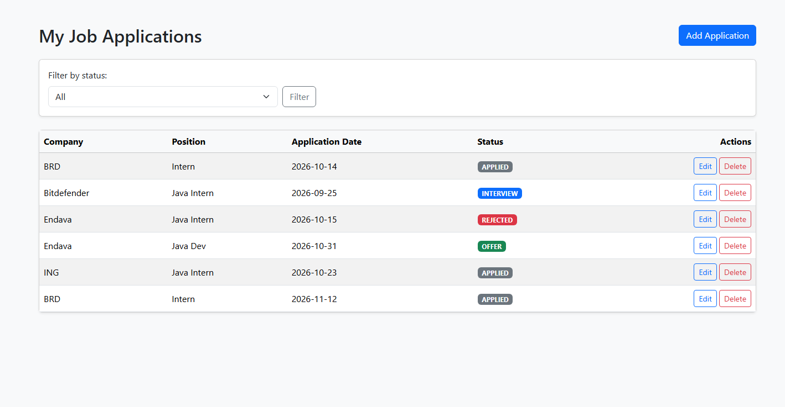
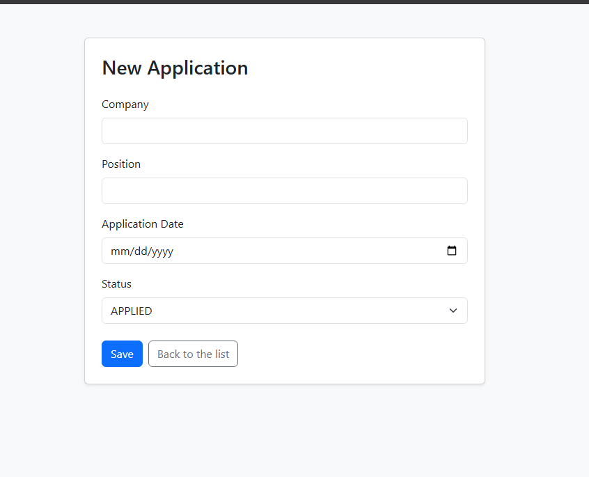
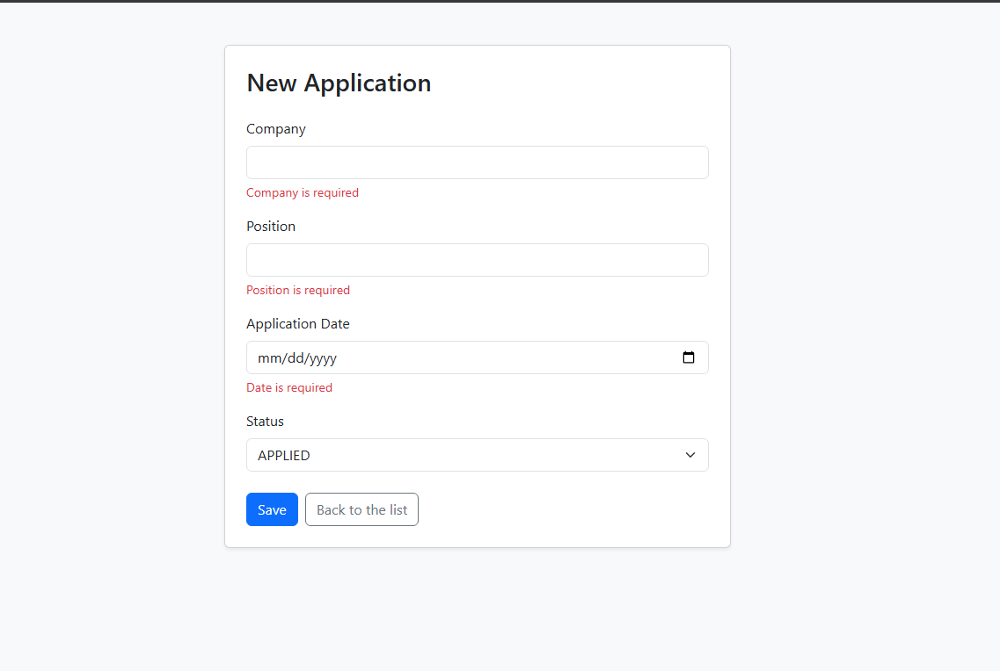
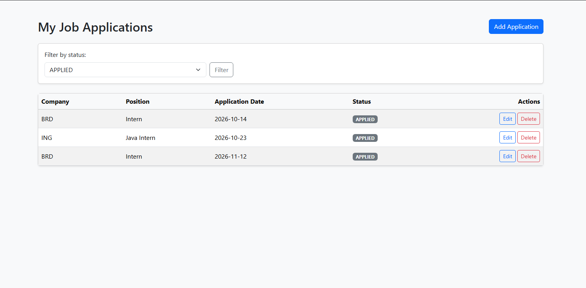

# Job Application Tracker

A web application for tracking job and internship applications.
Add, edit, delete and filter your applications by status.

## Features

- Full CRUD for job applications (create, read, update, delete)
- Form validation with error messages
- Application status as an enum (Applied, Interview, Offer, Rejected)
- Filter applications by status
- Layered architecture: Controller → Service → Repository

## Tech Stack

- Java 21
- Spring Boot (Spring MVC, Spring Data JPA)
- Thymeleaf
- MySQL
- Maven

## How to Run

1. Install JDK 21 and MySQL.
2. Create the database:
   ```sql
   CREATE DATABASE job_tracking;
   ```
3. Copy `src/main/resources/application.properties.example` to
   `src/main/resources/application.properties` and fill in your MySQL credentials.
4. Run the application:
   ```bash
   ./mvnw spring-boot:run
   ```
5. Open http://localhost:8080/applications


## Screenshots

### Applications list


### Add / edit form


### Validation


### Filter by status
